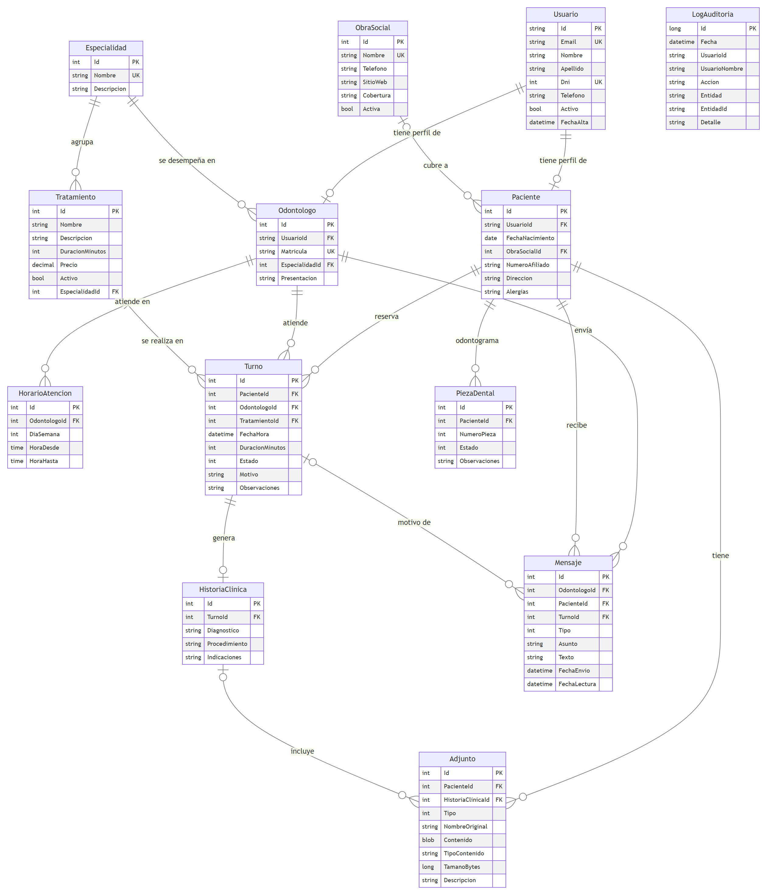

# Sonrisa Dental

Sistema de gestión de turnos para una clínica odontológica. Trabajo Final Integrador de **Programación Web**.

Los pacientes se registran y reservan turnos eligiendo tratamiento, odontólogo y un horario realmente libre; los odontólogos ven su agenda, atienden, cargan la **historia clínica, el odontograma y las radiografías**, y avisan a los pacientes ante cualquier inconveniente; la administración gestiona catálogos, personas y consulta un registro de auditoría. Un **asistente virtual con IA (Google Gemini)** responde dudas sobre horarios, tratamientos, precios y obras sociales, y orienta sobre qué especialidad consultar según los síntomas.

> Todos los datos de ejemplo son **ficticios**. No cargues datos reales de personas en este sistema.

📐 Diseño y diagrama de entidad-relación: [`docs/Hito1-Propuesta-y-Diseno.md`](docs/Hito1-Propuesta-y-Diseno.md) · DER como imagen/PDF: [`docs/DER.html`](docs/DER.html) · [`docs/DER.png`](docs/DER.png)  
📝 Explicación del DER (la base del modelo, las 16 relaciones y preguntas de defensa): [`docs/Explicacion-DER.docx`](docs/Explicacion-DER.docx)  
🤖 Cómo funciona el asistente de IA y cómo defenderlo: [`docs/Hito4-Asistente-IA.md`](docs/Hito4-Asistente-IA.md)  
🚀 Cómo publicarlo y entregarlo: [`docs/Despliegue.md`](docs/Despliegue.md)

## Modelo de datos

12 tablas propias más `Usuario` (la cuenta de ASP.NET Core Identity). `Turno` es la tabla central: une paciente, odontólogo y tratamiento.



## Tecnologías

- ASP.NET Core MVC (.NET 9)
- Entity Framework Core 9 (Code First, migraciones) + SQL Server
- ASP.NET Core Identity con 3 roles: `Administrador`, `Odontologo`, `Paciente`
- Bootstrap 5, jQuery Validation (Unobtrusive), SweetAlert2, Bootstrap Icons
- Google Gemini (API REST consumida con `HttpClient`) para el asistente virtual

## Cómo ejecutarlo

**Requisitos:** [.NET 9 SDK](https://dotnet.microsoft.com/download/dotnet/9.0) y una instancia de SQL Server accesible (SQL Server Express, Developer o LocalDB).

```bash
cd ClinicaDental
dotnet run
```

Se abre en `http://localhost:5359` (perfil `https`: `https://localhost:7293`). Al arrancar, la aplicación **crea la base de datos `ClinicaDental_Hito4`, aplica las migraciones y carga los datos de ejemplo** (catálogos, 5 odontólogos con horarios, 5 pacientes, turnos, una historia clínica con odontograma, una radiografía, un presupuesto en PDF y mensajes). No hace falta ningún paso manual de base de datos.

> Si ya tenías creada la base con una versión anterior, la migración nueva se aplica sola, pero los datos de ejemplo nuevos (archivos y mensajes) **no se agregan** a una base que ya tiene datos. Para verlos, borrá la base `ClinicaDental_Hito4` y volvé a ejecutar.

### Cadena de conexión

Por defecto usa el SQL Server local con autenticación de Windows (`appsettings.json`):

```
Server=localhost;Database=ClinicaDental_Hito4;Trusted_Connection=True;TrustServerCertificate=True
```

> **Cada hito tiene su propia base y sus propios puertos** (Hito 2: `ClinicaDental`, puerto 5159 · Hito 3: `ClinicaDental_Hito3`, 5259 · Hito 4: `ClinicaDental_Hito4`, 5359), así que se pueden abrir y ejecutar las tres versiones sin que una pise a la otra.

Para usar otra instancia (por ejemplo LocalDB) sin tocar archivos versionados, definí una variable de entorno:

```bash
# Windows (PowerShell)
$env:ConnectionStrings__DefaultConnection = "Server=(localdb)\MSSQLLocalDB;Database=ClinicaDental_Hito4;Trusted_Connection=True;TrustServerCertificate=True"
```

### Clave de la IA (asistente virtual)

El asistente necesita una API key gratuita de Google Gemini ([Google AI Studio](https://aistudio.google.com/apikey), solo pide una cuenta de Google). **La clave no se escribe en ningún archivo del proyecto**: se guarda en los secretos de usuario de .NET.

```bash
cd ClinicaDental
dotnet user-secrets set "Gemini:ApiKey" "PEGA-TU-CLAVE-ACA"
```

En un hosting se define la variable de entorno `Gemini__ApiKey`. Sin clave, todo el sistema funciona igual y el chat avisa que todavía no está configurado.

Los modelos se prueban en el orden de `Gemini:Modelos` (`appsettings.json`): Google retira modelos seguido y `gemini-2.5-flash` ya no se ofrece a claves nuevas, así que si uno no existe o no tiene cuota se pasa al siguiente. Se puede forzar uno con `Gemini:Modelo`.

### Datos de ejemplo

Se controlan con `"SeedDatosEjemplo"` en `appsettings.json` (`true` por defecto). Con `false` solo se crean los roles y la cuenta del administrador.

## Cuentas de prueba

| Rol | Correo | Contraseña |
|---|---|---|
| Administrador | `admin@clinica.com` | `Admin123!` |
| Odontólogo | `odontologo@clinica.com` | `Odonto123!` |
| Paciente | `paciente@clinica.com` | `Paciente123!` |

La pantalla de inicio de sesión muestra estas cuentas con un botón para completar el formulario. También se puede crear un paciente nuevo desde **Registrarme**.

## Funcionalidades por rol

**Todos los roles (con sesión iniciada)**
- **Asistente virtual "Sonri"** (botón flotante *Consultas*, abajo a la derecha): contesta con los datos reales de la clínica (profesionales y horarios, tratamientos con precio y duración, obras sociales y su cobertura), orienta sobre qué especialidad conviene según los síntomas, avisa ante una urgencia y explica cómo usar cada pantalla según el rol. **No diagnostica ni accede a turnos o historias clínicas.** Tiene atajos con preguntas frecuentes, recuerda la conversación mientras la pestaña está abierta y funciona en celular.

**Paciente**
- Registro de cuenta propia.
- Sacar turno: elige tratamiento → odontólogo (solo los de esa especialidad) → fecha → horarios libres calculados en el momento. Se puede empezar desde **Tratamientos** o desde **Profesionales**, con el tratamiento (y el profesional) ya elegidos.
- Ver sus turnos con períodos rápidos (próximos, hoy, 7 días, historial) y cancelar los que no vaya a usar.
- **Profesionales:** quiénes atienden, en qué días y qué tratamientos hace cada uno, con precio y duración.
- **Mi perfil:** actualiza teléfono, dirección, obra social y alergias, ve la cobertura de su obra social y cambia su contraseña.
- **Mi historia clínica:** sus consultas (diagnóstico, procedimiento e indicaciones), el odontograma con el estado de cada pieza y sus radiografías y estudios, que puede ver y descargar.
- **Mensajes:** recibe los avisos de su odontólogo (demora, reprogramación, cancelación...), con un contador de sin leer y accesos directos para cancelar o sacar otro turno.

**Odontólogo**
- Agenda con filtros por período, estado y texto; ve teléfono, obra social y alergias del paciente.
- Confirmar, marcar como atendido o ausente, y cancelar sus turnos. Al marcar "Atendido" el sistema ofrece cargar la historia clínica en el momento.
- **Mis pacientes y ficha clínica:** historia clínica por consulta, **odontograma** (32 piezas con numeración FDI, rotuladas por cuadrante y con el nombre de cada pieza, coloreadas según su estado) y **archivos** (radiografías en JPG/PNG/WEBP y estudios o presupuestos en PDF, hasta 5 MB).
- **Avisar al paciente ante un inconveniente:** desde un turno o desde la ficha, con plantillas según el motivo (demora, reprogramación, cancelación, indicaciones) que se pueden editar. Al cancelar un turno el sistema ofrece avisar en el momento, y el odontólogo ve cuándo el paciente leyó el mensaje.
- **Mi perfil:** sus horarios de atención, su matrícula y cambio de contraseña.

**Administrador**
- ABM de **pacientes**, **odontólogos** (con sus horarios de atención), **especialidades**, **tratamientos** y **obras sociales**.
- Gestión de todos los turnos: reservar para cualquier paciente, reprogramar, cambiar estado, eliminar.
- Tablero con números que son enlaces (turnos de hoy, pendientes de confirmar...) y atajos para ver los turnos de un paciente o la agenda de un odontólogo.
- **Auditoría:** quién creó, modificó o eliminó cada registro y cuándo, con el valor anterior y el nuevo.

## Reglas de negocio destacadas

- Un horario libre es el que cae dentro de una franja de atención del odontólogo, no se superpone con otro turno activo y no está en el pasado.
- Un paciente no puede tener dos turnos superpuestos, ni siquiera con distintos odontólogos.
- La doble reserva simultánea la frena también la base de datos (índice único filtrado).
- Un turno atendido, ausente o cancelado no se puede reabrir. Un paciente solo puede cancelar turnos propios y futuros.
- La ficha clínica es privada: el paciente ve la suya, un odontólogo ve la de los pacientes con los que tiene o tuvo turnos, y **la administración no accede a ella**. Los archivos se descargan solo a través de un controlador que verifica quién los pide.
- Un odontólogo solo puede escribirle a pacientes de su agenda. Los mensajes son de un solo sentido: el paciente los lee y puede cancelar o sacar otro turno.
- No se puede eliminar algo que tiene datos asociados (un tratamiento con turnos, un odontólogo con turnos, etc.): el sistema lo explica y, para personas, ofrece desactivar la cuenta. Una cuenta desactivada no puede iniciar sesión.

## Estructura del proyecto

```
ClinicaDental/
├── Controllers/     un controlador por pantalla (ABM, ficha clínica, mensajes, endpoints AJAX)
├── Models/          entidades de EF Core, enums y reglas de dominio
│   └── ViewModels/  modelos de formulario (personas, turnos, ficha, mensajes, perfil)
├── Data/            DbContext (con la auditoría automática), migraciones y datos de ejemplo
├── Services/        disponibilidad de turnos, acceso a la ficha, validación de archivos, mensajes sin leer, hora de Argentina
│                    y la IA: GeminiClient (HttpClient), AsistenteService (arma el System Prompt con datos de la base)
├── Views/           vistas Razor; cada ABM = Index + tabla parcial + formulario modal (el chat vive en Shared/_AsistentePartial)
├── Areas/Identity/  páginas de inicio de sesión, registro y acceso denegado
└── wwwroot/         CSS, JS (crud-async.js reutilizado por todas las pantallas; clinica.js para mensajes y archivos;
                     asistente.js para el chat flotante)
docs/                diseño (DER en md, html y png, y su explicación en Word), asistente de IA y guía de despliegue
Dockerfile           imagen para hostings con contenedores
```

## Seguridad

- Autorización por rol en el servidor en cada acción, más verificación de pertenencia del registro (un paciente no ve ni toca turnos ajenos).
- Token antifalsificación en todos los formularios y en las llamadas AJAX.
- Los formularios de personas y turnos usan ViewModels y las propiedades de navegación están marcadas `[BindNever]`, para impedir *overposting*.
- El login no revela si un correo está registrado; bloquea la cuenta 5 minutos tras 10 intentos fallidos.
- **Archivos:** se validan por su contenido real (no por lo que declara el navegador), con tope de 5 MB, y se guardan en la base de datos, nunca en una carpeta pública.
- **Auditoría sin filtrar datos clínicos:** historia clínica, mensajes y archivos registran quién y cuándo, pero no su contenido.
- Cabeceras de seguridad en todas las respuestas, cookies de sesión `HttpOnly` y `Secure` detrás de HTTPS.
- Sin secretos en el repositorio: la cadena de conexión de producción y la clave de la API de IA van por variables de entorno o `dotnet user-secrets`.
- **Asistente de IA:** solo para personas con sesión iniciada; token antifalsificación en cada consulta; tope de 8 consultas por minuto por persona (la cuota gratuita es chica y compartida); la conversación se valida y se recorta en el servidor (no se confía en lo que manda el navegador); a Google solo viajan datos públicos de la clínica y el rol, nunca datos de pacientes; la clave viaja en una cabecera y no en la URL; lo que contesta la IA se escapa antes de mostrarse; no se guarda el contenido de las conversaciones.

## Estado del trabajo

- [x] **Hito 1** — Propuesta y diseño (DER y roles)
- [x] **Hito 2** — Base de datos con EF Core, Identity, CRUD principales y auditoría
- [x] **Hito 3** — Historia clínica, odontograma, archivos (radiografías y PDF), mensajes del odontólogo al paciente, y preparación del despliegue (`Dockerfile`, `/healthz`, guía)
- [ ] **Publicación:** subir a GitHub y publicar en un hosting (requiere tus cuentas; pasos en [`docs/Despliegue.md`](docs/Despliegue.md))
- [x] **Hito 4 (código)** — Módulo de IA: chat flotante con Gemini, con el contexto armado desde la base. Probado con un Gemini simulado; falta probarlo con tu clave real
- [ ] **Hito 4 (defensa)** — Ensayar la demo en vivo y las preguntas de código (ver [`docs/Hito4-Asistente-IA.md`](docs/Hito4-Asistente-IA.md))

**URL pública:** _pendiente: completar después de publicar (ver `docs/Despliegue.md`)_
