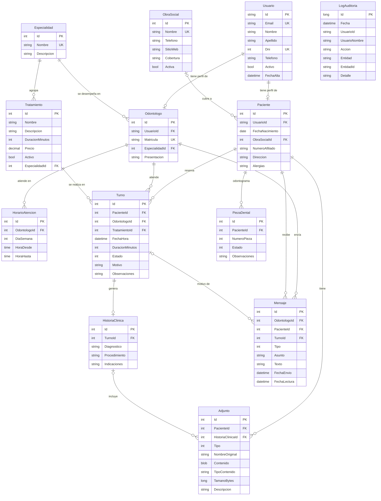

# Hito 1 — Propuesta y diseño

**Proyecto:** Sonrisa Dental — sistema de gestión de turnos para una clínica odontológica
**Materia:** Programación Web · Trabajo Final Integrador
**Tecnología:** ASP.NET Core MVC (.NET 9) · Entity Framework Core · SQL Server · ASP.NET Core Identity · Bootstrap 5

---

## 1. Tema elegido

Una clínica odontológica necesita ordenar la agenda de sus profesionales y que los pacientes puedan reservar sin llamar por teléfono. El sistema permite:

- Que un **paciente** se registre, elija un tratamiento, un odontólogo y un horario realmente libre, y pueda cancelar.
- Que cada **odontólogo** vea su agenda del día y marque cómo va cada turno (confirmado, atendido, ausente).
- Que la **administración** mantenga los catálogos (especialidades, tratamientos, obras sociales), las personas (pacientes y odontólogos con sus horarios) y revise quién hizo qué.

Corresponde a la idea *"Gestión de Turnos y Citas Médicas / Estéticas"* de la guía del TFI. Lo que lo distingue de un sistema de turnos genérico es el dominio odontológico: historia clínica por consulta, odontograma (estado de cada pieza dental) y archivos del paciente (radiografías y presupuestos).

## 2. Roles de usuario

Tres roles, administrados con ASP.NET Core Identity:

| Capacidad | Paciente | Odontólogo | Administrador |
|---|:---:|:---:|:---:|
| Registrarse por su cuenta | ✅ | — | — |
| Ver el catálogo de tratamientos y precios | ✅ | ✅ | ✅ |
| Ver los profesionales, sus horarios y tratamientos | ✅ | ✅ | ✅ (con su gestión completa) |
| Actualizar sus datos de contacto y cambiar su contraseña | ✅ | ✅ | ✅ |
| Sacar un turno (solo para sí mismo) | ✅ | — | ✅ (para cualquier paciente) |
| Ver sus turnos | ✅ (los suyos) | ✅ (su agenda) | ✅ (todos) |
| Cancelar un turno | ✅ (solo los suyos, futuros) | ✅ (los suyos) | ✅ |
| Cambiar el estado de un turno (confirmar / atendido / ausente) | — | ✅ (los suyos) | ✅ |
| Reprogramar o editar un turno | — | — | ✅ |
| Gestionar pacientes | — | — | ✅ |
| Gestionar odontólogos y sus horarios de atención | — | — | ✅ |
| Gestionar especialidades, tratamientos y obras sociales | — | — | ✅ |
| Cargar historia clínica, odontograma y archivos del paciente | — | ✅ (de sus pacientes) | — |
| Ver su propia historia clínica, odontograma y estudios | ✅ | ✅ (de sus pacientes) | — |
| Avisar a un paciente de un inconveniente (demora, reprogramación, cancelación) | — | ✅ | — |
| Recibir y leer esos avisos | ✅ | — | — |
| Consultar el registro de auditoría | — | — | ✅ |

> Los permisos se validan **siempre en el servidor** (atributos `[Authorize(Roles = ...)]` y comprobación de pertenencia del registro). Ocultar un botón en pantalla no se considera una medida de seguridad.

## 3. Diagrama de entidad-relación

> 🖼️ Para verlo como imagen, descargarlo en SVG o guardarlo como PDF, abrí [DER.html](DER.html) en el navegador.

El modelo tiene **12 tablas propias**, además de las 7 de Identity (`AspNetUsers`, `AspNetRoles`, `AspNetUserRoles`, etc.). La guía pide un mínimo de 7 sin contar Identity.



`LogAuditoria` no tiene relación dibujada a propósito: guarda una copia del nombre de usuario en lugar de una clave foránea, para que el registro siga siendo legible aunque la cuenta se elimine.

Además, todas las entidades menos `LogAuditoria` incluyen los campos de auditoría `FechaCreacion`, `UsuarioCreacionId`, `FechaModificacion` y `UsuarioModificacionId` (se omiten del diagrama para no saturarlo).

### Descripción de las entidades

| Entidad | Qué representa |
|---|---|
| `Usuario` | Cuenta de acceso (hereda de `IdentityUser`). Nombre, apellido, DNI, teléfono y si está activa. |
| `Paciente` | Perfil de un usuario con rol Paciente: fecha de nacimiento, obra social, alergias. |
| `Odontologo` | Perfil de un usuario con rol Odontólogo: matrícula y especialidad. |
| `Especialidad` | Área de atención (Ortodoncia, Endodoncia, etc.). |
| `Tratamiento` | Prestación con duración y precio, perteneciente a una especialidad. |
| `ObraSocial` | Prepaga u obra social, con su cobertura y si el convenio está vigente. |
| `HorarioAtencion` | Franja en la que un odontólogo atiende un día de la semana (puede haber varias por día). |
| `Turno` | Reserva de un paciente con un odontólogo para un tratamiento, con estado. |
| `HistoriaClinica` | Registro clínico de una consulta (diagnóstico, procedimiento, indicaciones). |
| `Adjunto` | Archivo del paciente: radiografía (imagen) o presupuesto / estudio (PDF). Su contenido se guarda en la base. |
| `PiezaDental` | Estado de una pieza en el odontograma del paciente. Se usa la numeración FDI de las 32 piezas permanentes (11–18, 21–28, 31–38 y 41–48): el número identifica la pieza, no es una cantidad. |
| `Mensaje` | Aviso del odontólogo a un paciente ante un inconveniente, opcionalmente ligado a un turno; registra cuándo fue leído. |
| `LogAuditoria` | Registro de quién creó, modificó o eliminó cada dato, y cuándo. |

### Estados de un turno

```
Pendiente ──► Confirmado ──► Atendido
    │             │
    │             ├──► Ausente
    └─────────────┴──► Cancelado
```

`Atendido`, `Ausente` y `Cancelado` son estados finales: un turno cerrado no se reabre.

## 4. Decisiones de diseño (y por qué)

- **Perfil separado de la cuenta.** `Usuario` guarda solo lo común a todos (login, nombre, DNI). Los datos propios de cada rol viven en `Paciente` y `Odontologo`. Así un odontólogo no arrastra columnas de obra social ni un paciente una matrícula vacía, y se pueden agregar roles nuevos sin tocar la tabla de usuarios.
- **ViewModels en los formularios de personas y de turnos.** El alta de un odontólogo o de un paciente toca dos tablas (cuenta + perfil) y recibe una contraseña que no se guarda tal cual en ninguna; el turno se pide con fecha y hora por separado. Un ViewModel define exactamente qué campos acepta cada formulario y evita que un request armado a mano modifique otros (*overposting*). Para estos casos la cuenta y el perfil se guardan dentro de una **transacción**: o se crean los dos o ninguno.
- **Nada se borra en cascada.** Todas las relaciones usan `Restrict` salvo dos excepciones justificadas (los horarios se van con su odontólogo, el odontograma con su paciente). Si un registro tiene datos asociados, el sistema lo informa en lugar de borrar historia clínica por accidente; para personas se ofrece **desactivar la cuenta**.
- **La duración del turno se copia al reservar.** Si luego cambia la duración del tratamiento, los turnos ya dados no se corren ni se superponen.
- **Doble reserva imposible.** Además de validar la disponibilidad en el servidor, la base tiene un índice único filtrado sobre `(OdontologoId, FechaHora)` para turnos no cancelados: si dos personas confirman el mismo horario a la vez, la base rechaza a la segunda.
- **Auditoría en dos niveles, automática.** Cada tabla lleva "creado por / modificado por" (se ve en las pantallas de gestión), y además `LogAuditoria` guarda cada alta, cambio (con el valor anterior y el nuevo) y baja. Se completa dentro de `SaveChanges` del `DbContext`, por lo que ningún controlador puede olvidarse de auditar.
- **Los archivos del paciente viven en la base, no en una carpeta pública.** Una radiografía es información sensible: si estuviera en `wwwroot`, cualquiera con el enlace podría abrirla. Se guardan como `varbinary` y se descargan solo a través de un controlador que comprueba quién la pide (el propio paciente o un odontólogo con turnos con él; la administración no). Además se valida el formato por los primeros bytes del archivo y no por lo que declara el navegador, y se limita a 5 MB. Como ventaja, los archivos sobreviven a los hostings con disco temporal.
- **La ficha clínica es privada, también en la auditoría.** La administración gestiona personas y turnos pero no ve historias clínicas, mensajes ni archivos. Para que el registro de auditoría (que sí lee) no filtre ese contenido, las entidades marcadas con `[ReservadoEnAuditoria]` registran quién y cuándo, pero no *qué* contenían.
- **Los avisos al paciente solo salen de la agenda del odontólogo.** Solo puede escribirle a pacientes con los que tiene o tuvo un turno, el mensaje se redacta a partir de una plantilla según el motivo (demora, reprogramación, cancelación, indicaciones) y queda registrado cuándo el paciente lo leyó. Al cancelar un turno, el sistema ofrece avisar en el mismo momento.
- **Hora de la clínica.** El servidor de hosting suele estar en UTC; todas las fechas se calculan con la hora de Argentina para que "hoy", los horarios libres y la auditoría no salgan corridos tres horas.

## 5. Módulo de IA (Hito 4)

Se implementó la **Opción A de la guía: chat flotante con Google Gemini** (cuota gratuita), consumido con `HttpClient` desde un servicio del backend. La guía propone `gemini-2.5-flash`, pero Google lo restringió a quienes ya lo usaban, así que el servicio prueba una lista de modelos configurable (ver `docs/Hito4-Asistente-IA.md`).

- El *System Prompt* se arma con datos reales de la base: horarios de atención de cada odontólogo, tratamientos con duración y precio, y obras sociales con su cobertura.
- Orienta al paciente sobre qué especialidad le conviene según sus síntomas (por ejemplo, dolor al tomar frío → Odontología general o Endodoncia) y siempre aclara que **no diagnostica**.
- La API key se guarda con `dotnet user-secrets` en desarrollo y en una variable de entorno en producción: nunca en el repositorio.

## 6. Estado de los hitos

| Hito | Contenido | Estado |
|---|---|---|
| 1 | Tema, DER preliminar, roles | ✅ Este documento |
| 2 | Base creada con EF Core, Identity configurado, CRUD principales | ✅ Ver `README.md` |
| 3 | Historia clínica, odontograma, archivos (radiografías y PDF), mensajes del odontólogo al paciente, preparación del despliegue | ✅ Ver `README.md` y `docs/Despliegue.md` (falta publicar: requiere tus cuentas) |
| 4 | Módulo de IA (chat flotante con Gemini), defensa | ✅ Código y pruebas con Gemini simulado · falta probar con tu clave real y ensayar la defensa (ver `docs/Hito4-Asistente-IA.md`) |
